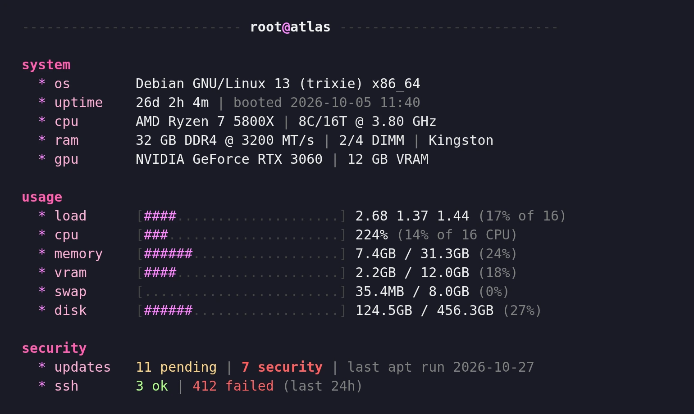
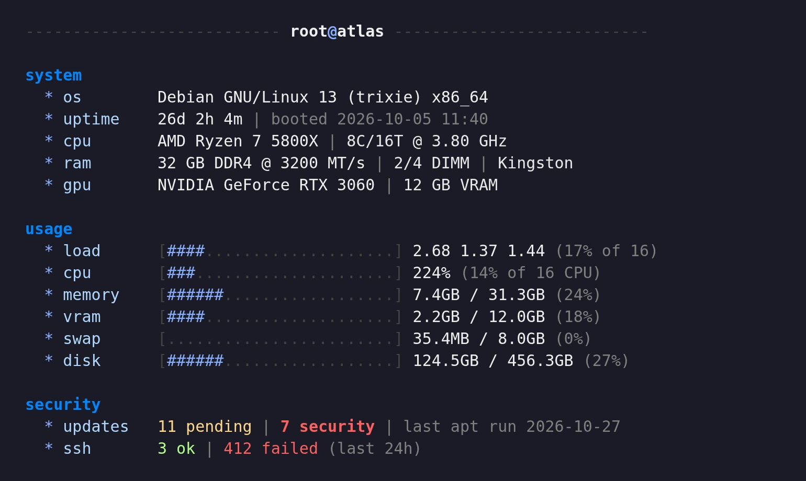
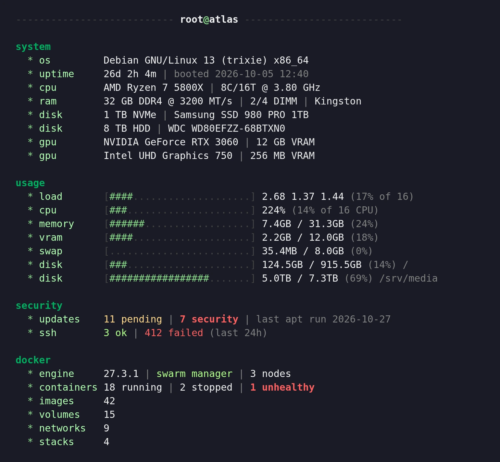
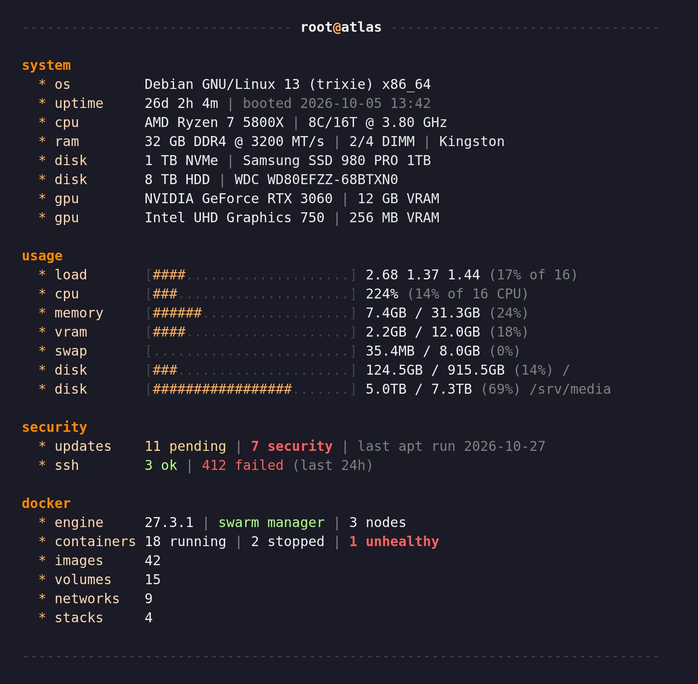
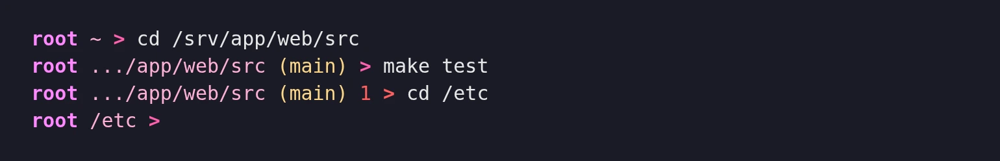

<h1 align="center">simple-motd</h1>

<p align="center">
  A fast login screen for your servers: the machine, its load and what needs your attention, the moment you SSH in.
</p>

<p align="center">
  <a href="LICENSE"></a>
  
  
</p>

simple-motd replaces the login messages of a Debian, Ubuntu, Fedora or Arch server with one screen in three parts: **system** (OS, uptime, CPU, RAM, disks, GPUs), **usage** (load, CPU, memory, VRAM, swap and each file system, as bars) and **security** (pending updates, security ones apart, and the SSH logins that worked and failed over the last 24 hours), and **docker** when it is installed (version, swarm, containers, images, volumes, networks, stacks). It shows at SSH logins and, if you want, in every new local terminal (Konsole, GNOME Terminal...). A systemd timer gathers the slow values every minute, so the screen prints in a few milliseconds. It is plain shell with ASCII symbols only, and works whatever the login shell: bash, zsh or sh: no font, no runtime, nothing to keep up to date besides the repository.

## Screenshots

<p align="center">
  <a href="docs/previews/pink.webp"></a>
  <br><sub>The login screen, pink theme (the default).</sub>
</p>

<table>
  <tr>
    <td width="33%"><a href="docs/previews/blue.webp"></a><br><sub>Blue</sub></td>
    <td width="33%"><a href="docs/previews/green.webp"></a><br><sub>Green</sub></td>
    <td width="33%"><a href="docs/previews/orange.webp"></a><br><sub>Orange</sub></td>
  </tr>
</table>

<p align="center">
  <a href="docs/previews/prompt.webp"></a>
  <br><sub>The optional prompt: user, directory, git branch, and the exit status of a failed command.</sub>
</p>

The values come from a sample machine. How to make them again: [CONTRIBUTING.md](CONTRIBUTING.md#previews).

## Features

- **One screen, three parts**: system, usage and security, aligned, with bars that turn yellow from 70 % and red from 90 %.
- **Fast at login**: the screen reads a cache refreshed every minute by a systemd timer; the update list is recomputed only when the packages or their metadata change, and never goes to the network.
- **Updates** from apt (Debian, Ubuntu), dnf (Fedora) or pacman (Arch), with the security ones counted apart and the date of the last run.
- **SSH logins** that worked and failed over 24 hours, on one line. Only "ok" or "fail" and the time are kept: no address, no user name. Three modes:
  - `journal` (default): read from the journal of the sshd unit, or from `/var/log/auth.log` / `/var/log/secure` when the journal is not kept; sshd is left as it is.
  - `private`: sshd logs only to a file in RAM that simple-motd empties every minute, and nothing about SSH reaches the journal or the disk.
  - `off`: no SSH line.
- **Hardware details** where the machine gives them: DDR type, speed and modules from `dmidecode`; every physical disk (NVMe, SSD, HDD, model) from `lsblk`; every GPU with its VRAM from `lspci`, `nvidia-smi` or amdgpu; a virtual machine is marked as such.
- **Every file system** in the usage part, one bar each with its mount point, without Docker, snap or `/boot` (or the ones you list).
- **Docker part** when docker is installed: version and swarm role (manager with its nodes, worker, inactive), running, stopped, paused and unhealthy containers, images, volumes, networks, and stacks (swarm stacks, or compose projects off swarm).
- **Local terminals too**, with `--local`: every new tab or window of Konsole, GNOME Terminal, kitty... shows it once (not subshells, tmux, IDE terminals or `sudo -s`); each user can turn it off for themselves.
- **Fits the terminal**: in a narrow window the bars shrink and long lines are cut.
- **Four themes**: pink, blue, green, orange, picked at install time from a preview, changed later with `simple-motd theme <name>`.
- **Optional prompt** (`root ~ >`) for bash, zsh and POSIX sh (dash, ash, ksh), the same in all three, in the colours of the theme: directory, git branch read from `.git/HEAD` (git is never run), exit status in red after a failure.
- **Clean install**: one script, run again to change options, `--dry-run` to see what it would do; every file it replaces is copied first, and `uninstall.sh` gives the system back as it was.

## Requirements

- Debian 12 or 13, Ubuntu 22.04 or 24.04, Fedora 40 or 41, or Arch Linux (other versions and derivatives of these families likely work; anything else with `--force`).
- systemd, bash 4.2 or later (for the tools; the login shell can be bash, zsh or sh), root access.
- `pciutils` and, on x86, `dmidecode`; on Arch also `pacman-contrib` (`checkupdates`) and `arch-audit` (security updates): the installer offers to install them.
- `--ssh private` needs `/etc/ssh/sshd_config` to include `sshd_config.d` (the default on the systems above), and systemd 253 or later to keep the PAM messages out of the journal (Debian 13, Ubuntu 24.04, Fedora, Arch).

## Quick start

```bash
git clone <repository> simple-motd && cd simple-motd
sudo ./install.sh
```

The installer lists the packages it needs, shows the four themes and asks for one, then prints the screen as your next SSH login will show it. Common options:

```bash
sudo ./install.sh --theme green --prompt --replace-motd   # prompt too, hide the distribution's own messages
sudo ./install.sh --ssh private                           # count SSH logins without keeping any address
sudo ./install.sh --local                                 # also in every new local terminal (Konsole...)
sudo ./install.sh --dry-run                               # what would change, nothing changed
```

To update, `git pull` then `sudo ./install.sh` again: the options of the last install are kept. To remove it all, `sudo ./uninstall.sh`.

## Documentation

| Page | What it covers |
| --- | --- |
| [Installation](docs/installation.md) | Every option, what each one changes on the system, updates, removal |
| [Configuration](docs/configuration.md) | `/etc/simple-motd.conf`, the themes, the `simple-motd` command |
| [How it works](docs/how-it-works.md) | The cache, where each value comes from, the SSH modes, the prompt |

## Contributing

[CONTRIBUTING.md](CONTRIBUTING.md) covers the layout, the tests and the commit rules.

## License

[MIT](LICENSE)
